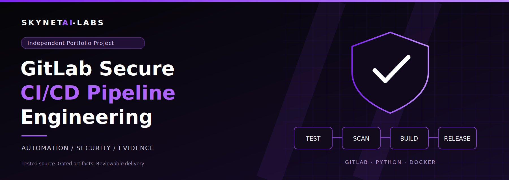

# GitLab Secure CI/CD Pipeline Engineering

[Canonical GitLab project](https://gitlab.com/SkynetAI-Labs/gitlab-secure-cicd-pipeline) · [GitHub source mirror](https://github.com/SkynetAI-Labs/gitlab-secure-cicd-pipeline)

A working DevSecOps lab from SkynetAI-Labs: a release-risk API, a fail-closed GitLab pipeline, and an evidence-based commercial case study. GitLab is the canonical CI platform; a GitHub copy is a source mirror, not a second deployment system.

## Portfolio labs

| Lab | Focus | Start here |
| --- | --- | --- |
| Lab 01 | Secure CI/CD engineering and recorded technical proof | [Technical verification](docs/VERIFICATION.md) and [commercial case study](docs/CASE_STUDY.md) |
| Lab 02 | Competitive evaluation and consultative sales discovery | [Hiring-team walkthrough, banner, and evaluation toolkit](docs/commercial/lab-02/README.md) |
| Lab 03 | Enterprise buyers, stakeholders and buying process | [Buyer hypotheses, committee map, and interview walkthrough](docs/commercial/lab-03/README.md) |
| Lab 04 | Commercial strategy and sales execution — final portfolio lab | [Selection, unsent outreach, execution model, and four-lab walkthrough](docs/commercial/lab-04/README.md) |

## What the project demonstrates

- A Flask API validates scan summaries and blocks release decisions when tests fail, secrets are detected, or high/critical findings exist.
- 52 API and policy tests include malformed JSON, body-size limits, incorrect types, and all blocking conditions. The coverage threshold is 95% with branch coverage enabled.
- Ruff, Bandit, Gitleaks, and pip-audit gate packaging. Runtime and CI dependencies are version- and hash-locked.
- A non-root, digest-pinned multi-stage container runs with a read-only filesystem and reduced privileges during smoke verification.
- Trivy blocks high/critical image vulnerabilities, including those without fixes. Scanner failures also block progress.
- Wheel, source archive, checksums, CycloneDX SBOM, test results, and scan reports provide traceable evidence.
- Registry publication is an optional manual step on the protected default branch, after the image scan passes. No production deployment is configured.

## Run locally

Requires Python 3.14, Docker for container verification, and network access to PyPI and advisory services. Use a virtual environment:

```bash
python3.14 -m venv .venv
. .venv/bin/activate
python -m pip install --require-hashes -r requirements-ci.lock
sh scripts/verify.sh
```

Run the service:

```bash
PYTHONPATH=src gunicorn --bind 127.0.0.1:8080 'release_gate:create_app()'
```

In another terminal:

```bash
python scripts/smoke.py
curl --fail http://127.0.0.1:8080/healthz
curl --fail -H 'Content-Type: application/json' -d '{"critical":0,"high":0,"medium":2,"low":4,"tests_passed":true,"secrets_found":false}' http://127.0.0.1:8080/evaluate
```

The response is `{"decision":"allow","reasons":[]}`. A high finding returns `block` with `high_findings`. Both are HTTP 200 business decisions; invalid summaries return HTTP 400, non-JSON bodies 415, oversized bodies 413. Counts must be nonnegative integers at most 1,000,000; booleans cannot substitute for counts. All six fields are mandatory and extra fields are rejected.

## Container

```bash
docker build -t release-gate:local .
docker run --rm --read-only --tmpfs /tmp:rw,noexec,nosuid,size=64m --cap-drop ALL --security-opt no-new-privileges -p 127.0.0.1:8080:8080 release-gate:local
```

Only bind publicly behind an authenticated, TLS-terminating gateway with rate limits. This demonstration trusts the submitted scan summary; it does not authenticate scanner evidence and must not authorize real deployments.

## Pipeline

`verify → package → container → image_scan → release`

Merge-request, branch, and tag pipelines are supported, with duplicate push pipelines suppressed for open merge requests. Ordinary stages wait for all prior stages. No scanner job allows failure. The optional manual registry job uses only the scanned image archive and a commit-SHA tag; no `latest` tag or automatic deployment is used.

Container jobs require a Docker executor supporting privileged Docker-in-Docker and a shared `/certs/client` TLS volume, as provided by compatible GitLab hosted Linux runners. Do not enable privileged mode on an untrusted shared host simply to run this lab. Runner availability, registry access, artifact size limits, protected branches, and compute quota are instance prerequisites. See [operations](docs/OPERATIONS.md).

## Evidence and case study

- [Verification record](docs/VERIFICATION.md): measured outcomes and limitations.
- [Threat model and security policy](docs/SECURITY.md).
- [Commercial case study](docs/CASE_STUDY.md): buyer problem, control mapping, illustrative economics, and adoption plan.
- [Setup handover](SETUP_HANDOVER.md): preserved setup history.
- [Original GitLab README](docs/original-gitlab-readme.md): starter content preserved before replacement.

No license has been selected; publication alone does not grant an open-source license. No customer, certification, production deployment, or measured financial saving is claimed.
