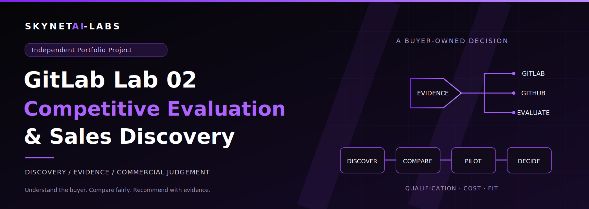

# GitLab Lab 02 — Competitive Evaluation & Sales Discovery

**Adam · SkynetAI-Labs · Independent Portfolio Project**

Prepared for GitLab's sales hiring team. Research checked 25 October 2026.

**The sales judgement:** establish a buyer-owned problem, recognise what already works, and propose a measured evaluation. A passing GitLab pipeline is technical evidence; it is not proof that a buyer should switch platforms.

## Start here: a six-minute interview walkthrough

| Time | Talk track | Open this evidence |
| --- | --- | --- |
| 0:00–0:45 | “I would first ask which release or evidence problem is costing the team time. The account, budget, urgency, and migration appetite are unqualified.” | [Account hypothesis and discovery cards](DISCOVERY.md) |
| 0:45–1:30 | “Lab 01 gives me something concrete to discuss: a working pipeline and its boundaries.” | [Lab 01 verification](../../VERIFICATION.md) and [successful pipeline 2985812654](https://gitlab.com/SkynetAI-Labs/gitlab-secure-cicd-pipeline/-/pipelines/2985812654) |
| 1:30–2:30 | “GitHub is a credible option. We should compare the required controls and ownership model, not YAML syntax.” | [Balanced comparison and entitlement checklist](COMPARISON.md) |
| 2:30–3:30 | “Before recommending a change, I would validate stakeholders, current commitments, and unacceptable migration costs.” | [Discovery](DISCOVERY.md) and [objection cards](OBJECTIONS.md) |
| 3:30–4:45 | “This blank cost model needs a complete quote and a baseline. Capacity returned is not automatically a cash saving.” | [Cost model guide](COST_MODEL.md) and [editable workbook](cost-model-template.xlsx) |
| 4:45–6:00 | “Let's agree one non-production service, measures, owners, and a decision date. Retain GitHub, choose GitLab, or gather more evidence depending on the result.” | [Pilot scorecard and decision rules](PILOT_SCORECARD.md) |

## The buyer scenario

Start with the [existing SaaS/fintech case study](../../CASE_STUDY.md), including its CTO/engineering buyer and platform/security stakeholders. Lab 02 adds qualification and a fair decision process rather than another fictional customer story. The account's size, stack, pain, budget, and timing remain unknown until discovery.

The existing £310/month example is an assumption-based capacity calculation. It is not measured savings, a GitLab price, or platform ROI. Its original assumptions remain in Lab 01; the new template separates operating cost, one-time change cost, and non-cash capacity.

## What was proved, researched, and proposed

- **Proved in Lab 01:** the configured pipeline passed for a recorded commit. Tests, external CLI scanners, container smoke checks, and their limits are recorded in the existing verification evidence.
- **Researched for Lab 02:** documented GitLab/GitHub capabilities and selected security entitlements, with primary sources and retrieval dates in the [source register](SOURCE_REGISTER.md).
- **Proposed, not executed:** the buyer discovery, competing-platform pilot, procurement quotes, cost forecasts, and thresholds in this section. No customer interviews, customer results, controlled cross-platform benchmark, or paid-feature trial are claimed.

Using Bandit, pip-audit, Gitleaks, and Trivy in GitLab CI does **not** demonstrate paid GitLab security products. The GitHub repository is a source mirror, not evidence of an equivalent GitHub Actions evaluation. GitHub Lab 03 is a separate project and is not a controlled comparison.

## Suggested next step

Offer a 30-minute discovery session and, only if a measurable gap and owner emerge, a scoped pilot with mutually agreed acceptance criteria. It is appropriate to recommend retaining GitHub or deferring a decision when the evidence does not justify change.

[Verification and presentation checks](VERIFICATION.md) · [Sources](SOURCE_REGISTER.md) · [Back to the project](../../../README.md)

No outreach was performed. No hiring contact or customer endorsement is implied. Deployment and optional registry publication are outside Lab 02.
