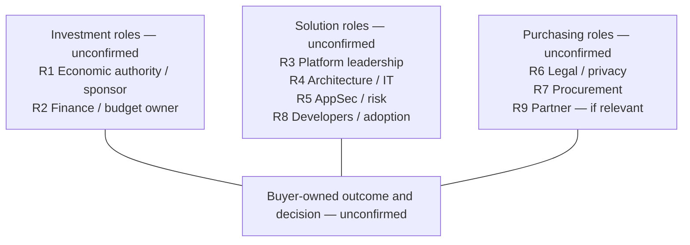

# Buying-committee map

**Fictional mapping exercise.** Lines below are proposed relationships to validate, not actual reporting lines, access or approved dependencies. R1–R9 match the [persona hypotheses](ENTERPRISE_BUYERS.md) and [CSV template](stakeholder-map.csv). Buyer names remain blank.

The map deliberately does not name a chair, champion, economic buyer or signer as confirmed. A future validated map should distinguish influence from actual approval authority and record directional dependencies where the buyer confirms them.

## Current role-play coverage

| Role(s) | Scenario input | What can be said | What cannot be said |
| --- | --- | --- | --- |
| R3 | H3: imagined enthusiasm | A potential supporter exists inside the role-play | Confirmed champion, executive access, resource authority or buyer technical acceptance |
| R4 / R5 | H4: imagined review interest | Technical/assurance participation would need mapping | Agreed criteria, approval, exception acceptance or completed product trial |
| R1 / R2 | H5 / H7 | Economic authority and funding are unknown | Identified buyer, available budget or intent to purchase |
| R6 / R7 | H6 | Paper-process participation is unknown | Approved terms, completed onboarding, signer or purchase-order readiness |
| R8 / R9 | H8 | Adoption and possible partner ownership require validation | Committed implementation resources or an involved partner |

## What to record and why

For each role, record **person (when legitimately known), outcome, approval scope, influence, stance, relationship/access, evidence type, source/date, confidence, next proposed action, and agreed owner/date**. Keep unknowns explicit. The CSV starts as an unconfirmed role inventory; it contains no real contacts and is not a completed account map.

A possible champion should be supported by observable, permission-based actions: helping involve relevant decision participants, validating the internal route, and co-authoring an accurate case for change. Friendliness and attendance are insufficient. GitLab's [public opportunity guidance](https://handbook.gitlab.com/handbook/sales/sales-operating-procedures/facilitate-the-opportunity/) discusses champion influence and access; it does not establish any actual relationship here.

If R3 is the only route into the organisation, flag single-contact dependence. Propose agreed access and broader participation without bypassing that person or contacting anyone. If a contact changes role, revalidate authority, sponsorship and process instead of assuming the opportunity remains intact.
