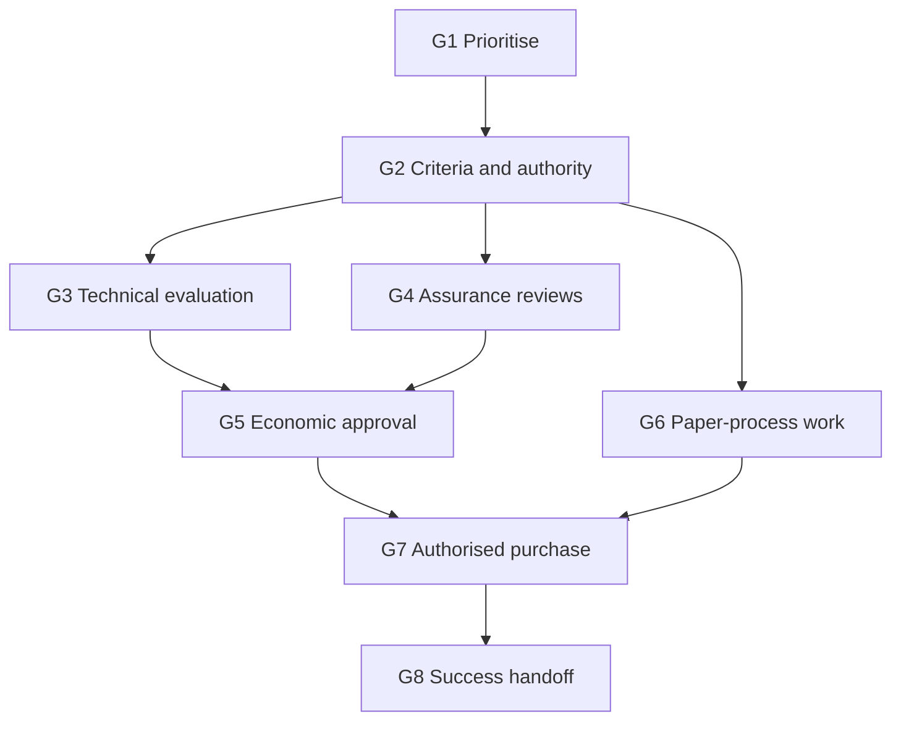

# Procurement and decision journey

**Proposed buyer-side journey, not a universal process or GitLab CRM stage model.** All steps are unagreed in the [fictional scenario](SCENARIO.md). Role IDs identify candidate owners, not people with confirmed authority. Dates, lead times, documents and purchasing routes must be established with the buyer.

| Gate | Proposed accountable buyer role(s) | Dependency / exit evidence | Current state |
| --- | --- | --- | --- |
| G1 · Prioritise the problem | R1 with R3 / R8 | Affected teams and sponsor confirm a material problem, scope and alternatives | H1: unvalidated |
| G2 · Agree decision structure | R1 with R2–R8 as required | Participants, authority, business/technical criteria and decision method accepted | H7: unknown |
| G3 · Complete technical evaluation | R3 / R4 with R8 and R5 | Buyer accepts results against agreed [Lab 02 criteria](../lab-02/PILOT_SCORECARD.md); remaining conditions documented | No buyer evaluation run |
| G4 · Complete required assurance reviews | R4 / R5 / R6 | Architecture/security/privacy reviewers accept evidence or record owned exceptions | H4 / H6: unconfirmed |
| G5 · Approve the economic case | R1 / R2 | Authorised decision, funding and complete cost scope confirmed, taking G3/G4 conditions into account | H5 / H7: unknown |
| G6 · Complete paper-process requirements | R6 / R7, with R9 if relevant | Buyer confirms required contract review, supplier onboarding, purchasing route, signer and any PO dependencies | H6 / H8: unknown |
| G7 · Execute the authorised purchase | Confirmed signer and purchasing authority | All required approvals and documents complete; approved purchasing evidence | No commitment or order |
| G8 · Hand off success/adoption ownership | R8 / R3 with buyer sponsor | Agreed responsibilities, success measures and implementation scope | H8: unconfirmed; no deployment |

G4 review planning and G6 process discovery can begin alongside G3 when the buyer agrees. Contract discussions do not establish funding, and a technical pass does not satisfy G5–G7. The signatory, economic decision-maker, procurement owner and budget holder may be different people. Validate the actual sequence rather than infer it from titles.

All arrows are proposed dependencies to validate, not completed tasks or a compulsory sequence. At any gate the buyer may retain the existing platform, defer, narrow the scope or stop. G8 is a planning handoff here, not an executed implementation.

## Keep three kinds of evidence separate

- **Decision criteria:** what the buyer will judge, including mandatory technical, operational and commercial requirements.
- **Decision process:** who evaluates, resolves trade-offs and gives the necessary approvals.
- **Paper process:** how the approved choice becomes an executable purchase through the buyer's required documents and controls.

GitLab's [MEDDPPICC handbook](https://handbook.gitlab.com/handbook/sales/meddppicc/) distinguishes these areas. Its [deal-closure guidance](https://handbook.gitlab.com/handbook/sales/sales-operating-procedures/deal-closure/) discusses joint planning of activities, owners and timing. The G1–G8 model is this portfolio's proposal, not a claim about a customer's actual procurement or GitLab's internal opportunity rules.

Use the [mutual action-plan CSV](mutual-action-plan.csv) to propose responsibilities and dependencies. Leave named owners and dates blank until genuinely agreed. A buyer may require an order form, security questionnaire, privacy review, master agreement, PO or other material; the list must come from their process. No document in this lab is legal advice, a contract, a quote, or an authorisation to purchase.
