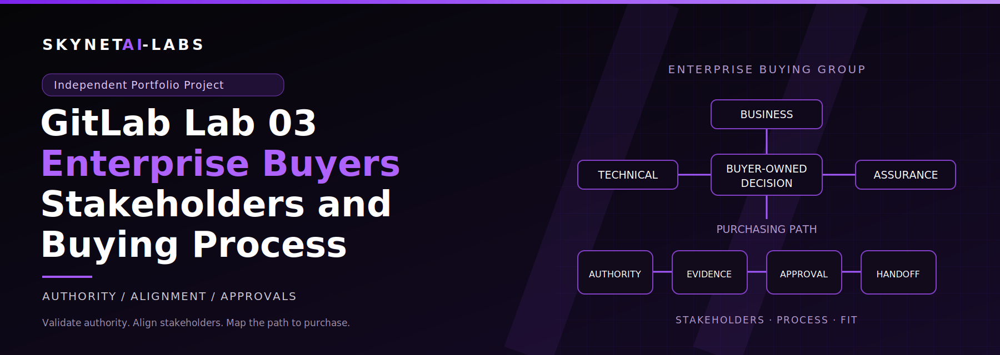

# GitLab Lab 03 — Enterprise Buyers, Stakeholders and Buying Process

**Adam · SkynetAI-Labs · Independent Portfolio Project**

Prepared for GitLab's sales hiring team. Primary sources reviewed 25 October 2026.

**The interview proposition:** a technical team liking a solution does not establish buying authority, funding, organisational approval, an executable purchase, or adoption. This lab demonstrates how I would make those gaps visible and propose a responsible next action.

## A six-minute walkthrough

| Time | Say / demonstrate | Open |
| --- | --- | --- |
| 0:00–0:45 | “This is a fictional enterprise situation. The lab results are real; the buyer, enthusiasm and buying process are hypotheses.” | [Scenario and evidence labels](SCENARIO.md) |
| 0:45–1:45 | “I would establish who sponsors, funds, approves, influences and signs, rather than infer authority from a job title.” | [Buyer-persona hypotheses](ENTERPRISE_BUYERS.md) |
| 1:45–2:45 | “The platform lead is a possible supporter, not a confirmed champion. Security, finance and procurement are not interchangeable.” | [Buying-committee map](BUYING_COMMITTEE.md) and [stakeholder priorities](STAKEHOLDER_PRIORITIES.md) |
| 2:45–4:00 | “Technical acceptance, economic approval and the paper process need different evidence. Reviews can run in parallel.” | [Procurement and decision journey](BUYING_PROCESS.md) |
| 4:00–5:00 | “Here are the gaps that prevent a purchase recommendation or a committed forecast.” | [Qualification gaps](QUALIFICATION_GAPS.md) |
| 5:00–6:00 | “The next proposed step is a buyer-approved roles and decision-path review, not a proposal or another generic demo.” | [Opportunity review and seller-team coordination](DEAL_REVIEW.md) and [proposed action-plan template](mutual-action-plan.csv) |

## Use the toolkit

- [Stakeholder-map template](stakeholder-map.csv): nine role hypotheses; names, authority, stance and access remain unconfirmed. It is not a contact list.
- [Mutual action-plan template](mutual-action-plan.csv): proposed gates, dependencies and evidence; all dates and actual owners remain blank. It is not an agreed close plan.
- [Source register and product-claim boundaries](SOURCE_REGISTER.md): dated primary sources and what they do—and do not—support.
- [Verification record](VERIFICATION.md): preservation, content/link checks, secret scanning, rendering and publication evidence.

## How this advances the portfolio

[Lab 01](../../VERIFICATION.md) provides recorded technical proof. [Lab 02](../lab-02/README.md) provides the discovery cards, balanced comparison, objections, cost model and pilot scorecard. Lab 03 links to those resources rather than copying their questions or constructing another ROI example. The [original outline](OUTLINE.md) is retained as planning history, not the current completion status.

The buyer model is my analysis, informed by public GitLab sources; it is not GitLab's official hiring rubric or a universal procurement process. No buyer was interviewed or contacted, no names or customer outcomes are invented, and no paid-product trial is claimed. No deployment, registry publication, legal conclusion, price promise or purchase commitment is made. GitHub's separate technical Lab 03 remains unrelated and unchanged.

[Back to the portfolio](../../../README.md)
