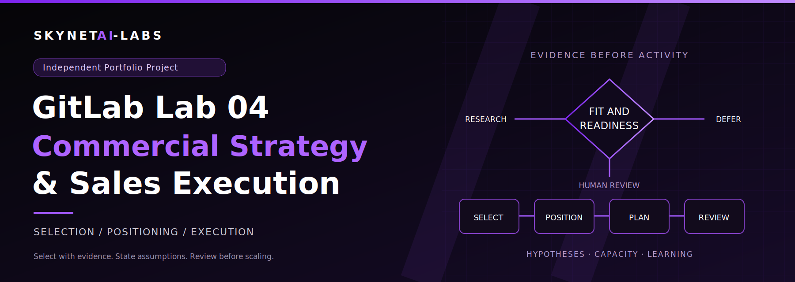

# GitLab Lab 04 — Commercial Strategy & Sales Execution

**Adam · SkynetAI-Labs · Independent Portfolio Project**

The final lab in this four-part portfolio, prepared for GitLab's sales hiring team. Primary sources reviewed 25 October 2026. This is a strategy and simulation, not a live campaign, employment claim or GitLab offer.

**The commercial judgement:** prioritise evidence rather than apparent fit alone, frame a buyer-relevant hypothesis, propose a proportionate next step, and measure learning without inventing pipeline or results. Every outreach draft is an **UNSENT PORTFOLIO EXAMPLE**. No one has been contacted.

## Six-minute hiring-team walkthrough

| Time | Explain | Evidence |
| --- | --- | --- |
| 0:00–0:45 | “Lab 01 gives me technical credibility, with explicit limits.” | [Recorded technical proof](../../VERIFICATION.md) |
| 0:45–1:20 | “Lab 02 keeps the evaluation fair, including retaining GitHub.” | [Comparison, discovery and cost/pilot toolkit](../lab-02/README.md) |
| 1:20–1:55 | “Lab 03 separates enthusiasm, authority, funding and purchasing.” | [Enterprise buying toolkit](../lab-03/README.md) |
| 1:55–3:00 | “Lab 04 selects where to investigate. Unknowns do not become zeros, and a high score cannot override a mandatory mismatch.” | [Selection method](ACCOUNT_SELECTION.md) and [fictional examples](ACCOUNT_EXAMPLES.md) |
| 3:00–4:15 | “I would tailor the value hypothesis and ask for a modest next step without claiming product outcomes.” | [Positioning](POSITIONING.md) and [unsent outreach examples](OUTREACH_EXAMPLES.md) |
| 4:15–5:15 | “The 30/60/90 plan is hypothetical. Funnel numbers are model assumptions, not meetings or pipeline I created.” | [Execution plan](EXECUTION_PLAN.md) and [funnel/capacity model](FUNNEL_MODEL.md) |
| 5:15–6:00 | “I would review evidence quality, constraints and buyer outcomes before scaling activity.” | [Success measures](SUCCESS_MEASURES.md) and [verification](VERIFICATION.md) |

## Working materials

- [Blank prioritisation CSV](prioritisation-template.csv), [fictional scored examples](fictional-accounts.csv), and [scoring/funnel inputs](model-inputs.json).
- [Reproducible calculation script](calculate_models.py) and [calculated model results](model-results.json). The script uses Python's standard library and has no sending or network capability.
- [Proposed follow-up sequence](sequence-template.csv): relative timing only, never an enrolled campaign.
- [Dated source register](SOURCE_REGISTER.md): documentary facts versus value hypotheses and simulations.
- [Handover](HANDOVER.md): deliverables, evidence boundaries and publication state.

The four account examples are invented placeholders, not researched organisations, prospects or customers. No personal contact data is present. The plan has no assigned territory, employer quota, validated conversion benchmark, paid-feature trial, customer result, revenue or achieved meeting claim. Labs 01–03 and GitHub's unrelated technical Lab 03 are preserved.

[Back to the four-lab portfolio](../../../README.md)
